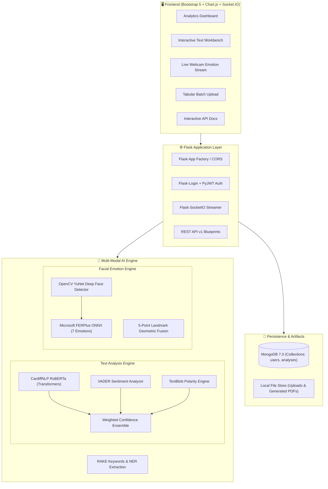

# 🧠 SentiVision AI — Intelligent Sentiment & Facial Emotion Analyzer

<div align="center">

[](https://python.org)
[](https://flask.palletsprojects.com/)
[](https://www.mongodb.com/)
[](https://huggingface.co/)
[](https://opencv.org/)
[](https://www.docker.com/)
[](LICENSE)

**An enterprise-grade, multi-modal AI platform unifying state-of-the-art NLP sentiment classification with real-time computer vision facial emotion recognition.**

[Key Features](#-key-features) • [Architecture](#-architecture) • [Live Demo & Screenshots](#-screenshots--ui) • [Quickstart](#-quickstart-guide) • [Docker Deployment](#-docker-deployment) • [REST API Reference](#-rest-api-reference) • [Tech Stack](#-technology-stack)

</div>

---

## 🌟 Overview

**SentiVision AI** is a production-ready artificial intelligence application designed to decode human sentiment and emotion across modalities. Whether inspecting written customer reviews, tracking brand reputation on social platforms, or monitoring live emotional engagement over webcam streams, SentiVision provides deep, actionable emotional intelligence.

### What Makes It "Best-of-the-Best":
- **Zero Authentication / Frictionless Open-Source:** No sign-up, registration, or login barriers. Every feature—from text and URL analysis to the live camera, batch jobs, and REST API—is immediately available to everyone.
- **Multi-Model NLP Ensemble:** Avoids single-model bias by combining deep learning transformers (**CardiffNLP Twitter-RoBERTa**), social-lexicon algorithms (**VADER**), and rule-based subjectivity engines (**TextBlob**) with configurable confidence weighting.
- **Real-Time Facial Expression Tracking & Simulator:** Leverages HTML5 Canvas, WebSocket streams via **Flask-SocketIO**, and **OpenCV / FER** to track faces and quantify the 7 primary universal emotions (*Happy, Sad, Angry, Surprise, Fear, Disgust, Neutral*). Includes a built-in **Virtual Face Simulator** so anyone can test the computer vision pipeline even without physical camera permissions!
- **Bulk Tabular Processing:** Seamlessly processes large datasets (CSV, JSON, Excel) with automatic text column detection, progress tracking, and batch export capabilities.
- **URL & Web Scraping Engine:** Extract product reviews and social discussions directly from URLs using intelligent DOM parsing.
- **Interactive Analytics Dashboards:** Glassmorphic UI featuring Chart.js doughnut charts, radar distributions, rolling timelines, keyword tag clouds, and downloadable PDF reports generated via Matplotlib.
- **Public REST API:** Fully documented, open API endpoints allowing external microservices and scripts to perform text and facial emotion inference programmatically with zero API key restrictions.

---

## 🚀 Key Features

| Category | Capability | Description |
|---|---|---|
| **Text Analysis** | Multi-Model Consensus | Combines RoBERTa (0.5), VADER (0.3), and TextBlob (0.2) into a unified ensemble score |
| | Aspect-Based Sentiment | Extracts specific product aspects and assigns sentiment polarity to each |
| | NLP Enrichment | Named Entity Recognition (NER), RAKE keyword extraction, and language detection |
| | URL Scraping | Scrapes online forums, review pages, and articles for bulk opinion mining |
| **Vision AI** | Live Webcam Stream | Real-time facial bounding box tracking and emotion percentage meter via OpenCV YuNet & FERPlus |
| | Hybrid AI Fusion | Deep neural emotion network fused with 5-point facial landmark geometric analysis |
| | CLAHE Contrast Adaptation | Contrast Limited Adaptive Histogram Equalization for illumination-invariant detection |
| | 7-Emotion Spectrum | Quantifies *Happy, Sad, Angry, Surprise, Fear, Disgust, and Neutral* |
| | Virtual Face Simulator | Interactive simulated stream for testing without a physical webcam |
| | Photo Sentiment | Drag-and-drop selfie/portrait analysis without requiring a live camera |
| **Batch Engine** | Tabular Ingestion | Drag-and-drop CSV, JSON, and XLSX file uploads with schema inspection |
| | Auto Column Detection | Heuristic detection of `review`, `comment`, `text`, or `body` columns |
| | Data Exports | Download processed results in CSV or JSON formats with full scoring |
| **Platform** | 100% Open Access | No login or registration required; instant access to all tools |
| | MongoDB Persistence | Scalable document storage for users, analyses, and audit records |
| | PDF & Visual Reports | Generate high-resolution Matplotlib charts and downloadable PDF summaries |
| | Dark / Light Theming | Modern glassmorphism interface styled with Bootstrap 5 and FontAwesome 6 |

---

## 🏗 Architecture



---

## 💻 Technology Stack

- **Backend Framework:** Python 3.9+, Flask 3.0, Flask-SocketIO, Flask-Login, Flask-CORS, Gunicorn, Eventlet
- **NLP & Deep Learning:** HuggingFace `transformers`, PyTorch, `vaderSentiment`, `textblob`, `nltk`, `rake-nltk`, `langdetect`
- **Computer Vision:** `opencv-python`, `fer` (Facial Expression Recognition), `deepface`, `Pillow`
- **Database:** MongoDB 7.0 via `pymongo` (NoSQL document store with aggregation pipelines)
- **Data & Export:** `pandas`, `openpyxl`, `matplotlib`, `reportlab`
- **Web Scraping:** `beautifulsoup4`, `requests`, `lxml`
- **Frontend:** Jinja2 Templates, Bootstrap 5.3, Chart.js 4, Socket.IO 4 Client, Font Awesome 6
- **DevOps & Containers:** Docker, Docker Compose, GitHub Actions CI/CD, Pytest

---

## ⚡ Quickstart Guide

### 1. Prerequisites
- **Python 3.9 - 3.11** installed on your system
- **MongoDB 6.0+** running locally on port 27017, or a free [MongoDB Atlas](https://www.mongodb.com/cloud/atlas) cluster
- **Git**

### 2. Clone Repository & Setup Virtual Environment
```bash
# Clone the repository
git clone https://github.com/your-username/sentiment-analyzer.git
cd "sentiment-analyzer"

# Create a virtual environment
python -m venv venv

# Activate virtual environment
# Windows:
venv\Scripts\activate
# macOS / Linux:
source venv/bin/activate
```

### 3. Install Dependencies
```bash
pip install --upgrade pip
pip install -r requirements.txt
```

### 4. Configure Environment Variables
Copy the sample environment file and adjust if necessary:
```bash
cp .env.example .env
```
Default `.env` configuration:
```env
FLASK_ENV=development
SECRET_KEY=sentivision-ultra-secure-key-change-in-production
JWT_SECRET_KEY=sentivision-jwt-secret-key-32chars
MONGO_URI=mongodb://localhost:27017/sentiment_analyzer
UPLOAD_FOLDER=app/uploads
MAX_CONTENT_LENGTH=16777216
PORT=5000
HOST=0.0.0.0
```

### 5. Seed Sample Database (Optional but Recommended)
Populate MongoDB with default accounts and 20+ realistic test analyses:
```bash
python scripts/seed_db.py
```
> Default Admin Credentials:
> - **Username:** `admin`
> - **Password:** `admin123`

### 6. Launch Application
```bash
python run.py
```
Open your browser and navigate to: **[http://localhost:5000](http://localhost:5000)**

---

## 🐳 Docker Deployment

Run the complete platform including MongoDB and Mongo Express with a single command:

```bash
# Start all containers in detached mode
docker-compose up -d --build
```

Access the services:
- **SentiVision AI Web Application:** [http://localhost:5000](http://localhost:5000)
- **Mongo Express DB Admin GUI:** [http://localhost:8081](http://localhost:8081)
- **MongoDB Database Port:** `localhost:27017`

To shut down:
```bash
docker-compose down
```

---

## 📖 Usage Guide

### 1. Text Sentiment Analysis
1. Navigate to **Analyze Text** in the top navigation.
2. Type or paste any product review, tweet, or document into the text area.
3. Select which models to enable (RoBERTa, VADER, TextBlob).
4. Click **Analyze Sentiment**.
5. Inspect the animated confidence meter, per-model breakdown, extracted keywords, named entities, and probability distribution.

### 2. Live Webcam Facial Emotion Tracking
1. Navigate to **Live Camera**.
2. Click **Start Camera** and grant browser webcam permissions.
3. Observe real-time bounding boxes drawn directly around your face with dominant emotion badges.
4. Watch the 7-emotion spectrum meters (*Happy, Sad, Angry, Surprise, Fear, Disgust, Neutral*) update 4 times per second.
5. Click **Capture Snapshot** to save timestamped emotion records to your session gallery.

### 3. Bulk Batch Processing
1. Navigate to **Batch Upload**.
2. Drag and drop any `.csv`, `.json`, or `.xlsx` review file into the drop zone.
3. The platform auto-detects column headers and displays a 5-row preview.
4. Verify the mapped review text column and click **Run Sentiment Analysis**.
5. View aggregate summary stats, download the filtered data, or export results directly to CSV or JSON.

---

## 🔌 REST API Reference

SentiVision exposes an enterprise-grade REST API (v1).

### 1. Generate JWT Access Token
```bash
curl -X POST http://localhost:5000/api/v1/auth/token \
  -H "Content-Type: application/json" \
  -d '{"username": "admin", "password": "admin123"}'
```
**Response:**
```json
{
  "status": "success",
  "access_token": "eyJhbGciOiJIUzI1NiIsInR5cCI6IkpXVCJ9...",
  "token_type": "Bearer",
  "expires_in": 86400
}
```

### 2. Analyze Text Sentiment
```bash
curl -X POST http://localhost:5000/api/v1/analyze/text \
  -H "Content-Type: application/json" \
  -d '{
    "text": "The display is vibrant and sharp, though battery backup could be slightly higher.",
    "models": ["transformer", "vader", "textblob"]
  }'
```
**Response:**
```json
{
  "status": "success",
  "data": {
    "sentiment": {
      "overall_sentiment": "positive",
      "overall_confidence": 0.84,
      "ensemble_scores": {
        "positive": 0.68,
        "neutral": 0.22,
        "negative": 0.10
      },
      "models": {
        "transformer": { "label": "positive", "confidence": 0.88 },
        "vader": { "compound": 0.42, "label": "positive" },
        "textblob": { "polarity": 0.35, "subjectivity": 0.50, "label": "positive" }
      }
    },
    "keywords": [
      { "keyword": "display", "score": 2.0 },
      { "keyword": "battery backup", "score": 4.0 }
    ],
    "language": { "language": "en", "confidence": 0.99 }
  }
}
```

### 3. Analyze Batch Texts
```bash
curl -X POST http://localhost:5000/api/v1/analyze/batch \
  -H "Content-Type: application/json" \
  -d '{
    "texts": [
      "Outstanding build quality, highly recommended!",
      "Defective unit, arrived broken and customer support was unresponsive.",
      "The package contains one black adapter and warranty card."
    ]
  }'
```

### 4. Facial Emotion Analysis from Photo
```bash
curl -X POST http://localhost:5000/api/v1/analyze/image \
  -F "image=@portrait.jpg"
```

For complete documentation with interactive examples, visit **[http://localhost:5000/api-docs](http://localhost:5000/api-docs)**.

---

## 📁 Project Structure

```
Sentiment Analyzer/
├── .github/
│   └── workflows/
│       └── ci.yml               # GitHub Actions CI/CD pipeline
├── app/
│   ├── __init__.py              # Application factory & extension wiring
│   ├── config.py                # Environment configurations (Dev/Prod/Test)
│   ├── models/
│   │   ├── __init__.py
│   │   ├── user.py              # MongoDB-backed User model with bcrypt
│   │   └── analysis.py          # Sentiment Analysis document model & aggregations
│   ├── routes/
│   │   ├── __init__.py
│   │   ├── main.py              # Dashboard, About, Health check
│   │   ├── auth.py              # Login, Register, Logout, Profile
│   │   ├── analysis.py          # Single text, URL scraping, history
│   │   ├── camera.py            # Live webcam WebSocket & snapshot routes
│   │   ├── batch.py             # Bulk CSV/JSON upload & file processing
│   │   ├── api.py               # REST API (v1) with JWT Bearer auth
│   │   └── reports.py           # Matplotlib chart images & PDF downloads
│   ├── services/
│   │   ├── __init__.py
│   │   ├── text_analyzer.py     # RoBERTa + VADER + TextBlob ensemble
│   │   ├── facial_analyzer.py   # OpenCV + FER facial emotion detector
│   │   ├── batch_processor.py   # Tabular file reader, auto-detector & exporter
│   │   ├── scraper.py           # BeautifulSoup web scraping module
│   │   ├── nlp_utils.py         # Keyword extraction, NER & language detection
│   │   └── report_generator.py  # Matplotlib visualization & PDF engine
│   ├── static/
│   │   ├── css/
│   │   │   └── style.css        # Glassmorphic custom stylesheet
│   │   ├── js/
│   │   │   ├── common.js        # Theme toggles, toasts & loading overlays
│   │   │   ├── dashboard.js     # Chart.js dashboard charts & counters
│   │   │   ├── analyzer.js      # Text analysis AJAX workbench
│   │   │   ├── camera.js        # Webcam streaming & bounding box overlays
│   │   │   └── batch.js         # Tabular drop-zone, preview & pagination
│   │   └── img/
│   │       └── logo.svg         # Gradient SVG brand logo
│   └── templates/
│       ├── base.html            # Core HTML5 layout with dark/light navbar
│       ├── dashboard.html       # Analytics overview dashboard
│       ├── analyze.html         # Interactive text sentiment workbench
│       ├── camera.html          # Live camera emotion analysis
│       ├── batch.html           # Batch review dataset upload
│       ├── history.html         # Filterable analysis history
│       ├── report.html          # Detailed single-record report
│       ├── api_docs.html        # Interactive REST API reference
│       ├── login.html           # Sign in view
│       ├── register.html        # User registration view
│       ├── about.html           # System architecture & capabilities
│       ├── profile.html         # Account details & stats
│       └── errors/              # 404, 413, and 500 error templates
├── scripts/
│   └── seed_db.py               # Database seeder script
├── tests/
│   ├── __init__.py
│   ├── conftest.py              # Pytest fixtures & mock configs
│   ├── test_text_analyzer.py    # NLP engine unit tests
│   ├── test_facial_analyzer.py  # Computer vision unit tests
│   ├── test_routes.py           # Flask integration tests
│   └── test_api.py              # REST API integration tests
├── .env.example                 # Environment variables template
├── .gitignore                   # Comprehensive Python & AI gitignore
├── CONTRIBUTING.md              # Open-source contribution guidelines
├── docker-compose.yml           # Multi-service composition (Web + Mongo)
├── Dockerfile                   # Multi-stage production container
├── LICENSE                      # MIT Open Source License
├── requirements.txt             # Production dependency pins
├── run.py                       # WSGI / SocketIO entry point
└── setup.py                     # Package setup script
```

---

## 🧪 Testing

The project includes unit and integration tests covering routes, NLP engines, vision fallbacks, and API endpoints.

To run the test suite:
```bash
# Run all tests with coverage report
pytest -v --cov=app tests/

# Run specific test file
pytest tests/test_text_analyzer.py -v
```

---

## 🔒 Security Best Practices

- **Password Encryption:** Passwords hashed using `bcrypt` with individual salt generation.
- **Stateless Tokens:** JWT expiration enforced on protected API endpoints.
- **Upload Hardening:** Filenames sanitized via `werkzeug.utils.secure_filename`, with extension whitelisting and 16MB file size caps.
- **Graceful Degradation:** The entire application gracefully runs even if external dependencies (like MongoDB or GPU transformers) are offline or loading.

---

## 🤝 Contributing

Contributions, issues, and feature requests are welcome!
1. Fork the Project
2. Create your Feature Branch (`git checkout -b feature/AmazingFeature`)
3. Commit your Changes (`git commit -m 'Add some AmazingFeature'`)
4. Push to the Branch (`git push origin feature/AmazingFeature`)
5. Open a Pull Request

Please read [CONTRIBUTING.md](CONTRIBUTING.md) for details on code style and pull request requirements.

---

## 📄 License

Distributed under the **MIT License**. See [LICENSE](LICENSE) for more information.

---

<div align="center">
Built with ❤️ using Flask, Hugging Face Transformers &amp; OpenCV.
</div>
